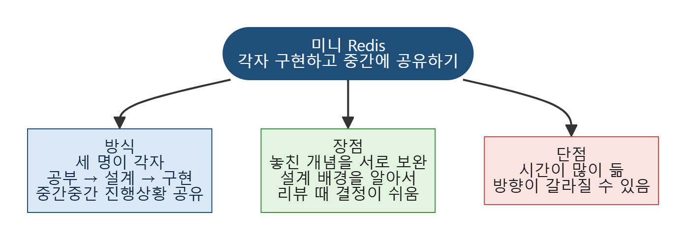
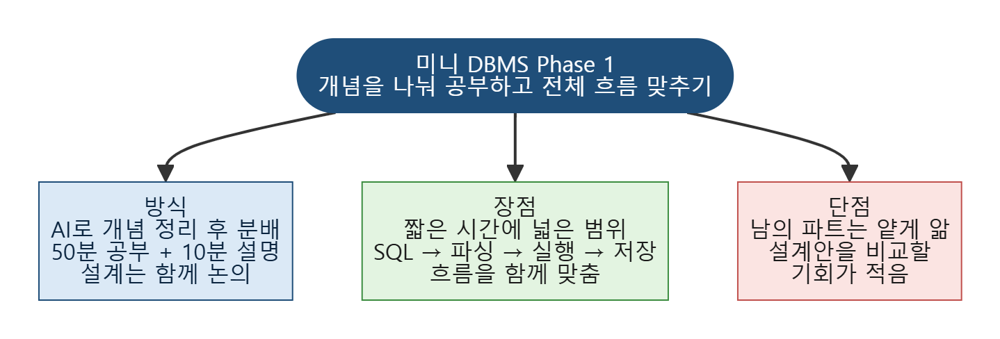
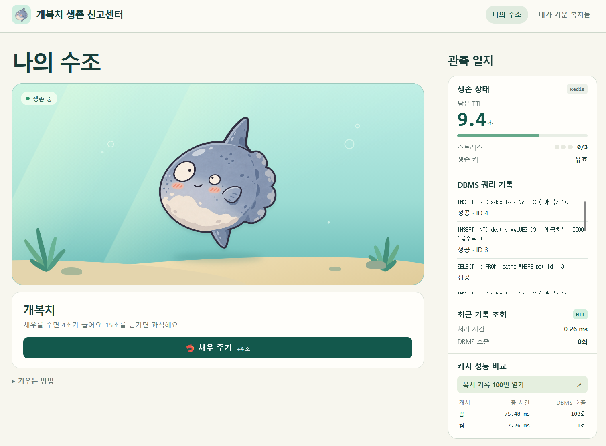
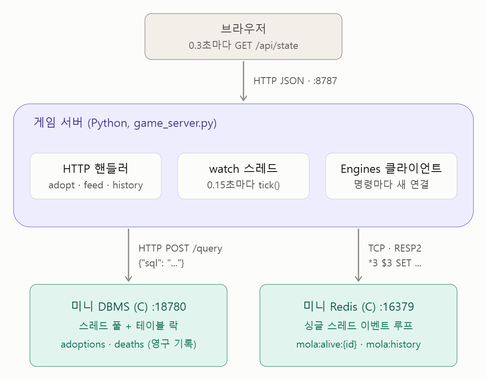
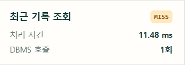
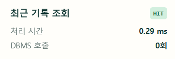
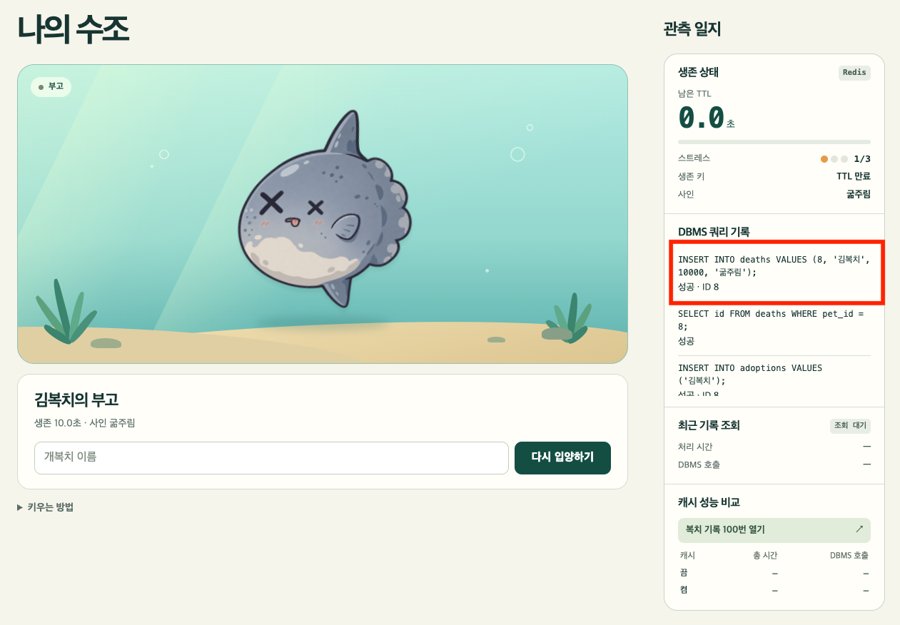
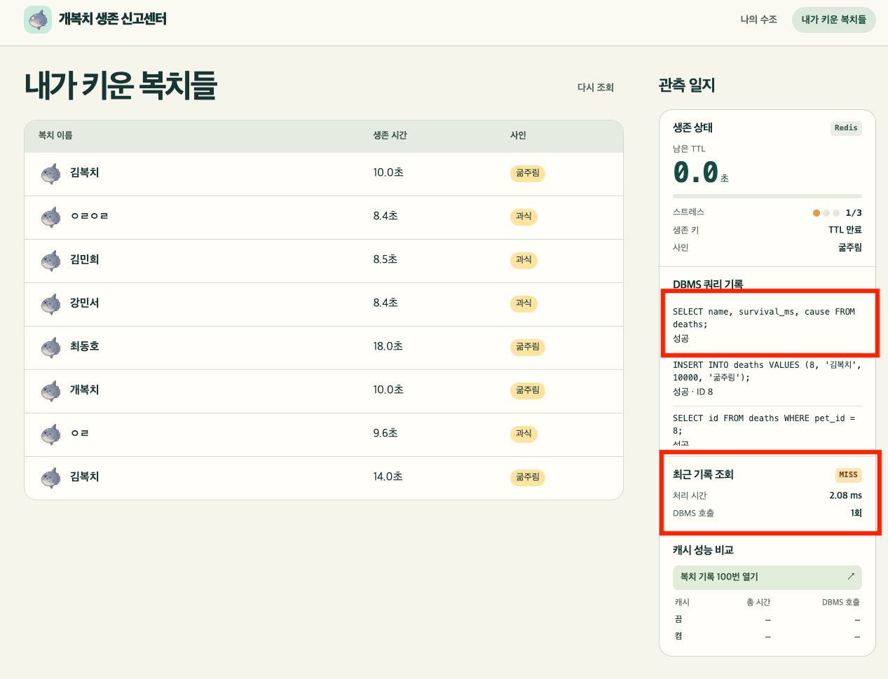

# 개복치 생존 신고센터

## 1. 협업 방식

### 미니 Redis: 각자 구현하고 중간에 공유하기


Mini Redis 프로젝트에서는 세 명이 각자 학습부터 구현까지 독립적으로 진행하고, 중간중간 진행 상황을 공유했습니다. 덕분에 같은 문제를 서로 다른 관점에서 해결한 결과물을 비교할 수 있었지만, 각 코드의 장단점을 분석하고 하나로 통합하는 데 많은 시간이 들었습니다.

### 미니 DBMS Phase 1: 개념을 나눠 공부하고 전체 흐름 맞추기

이 경험을 바탕으로 DBMS 프로젝트에서는 협업 방식을 바꿨습니다. AI를 활용해 시간 단위로 학습 범위와 질문을 정하고, 개념을 분담해 학습한 뒤 공유했습니다. 다양한 구현 방식을 탐색하기보다 팀원들이 공통된 이해와 설계 방향을 갖는 데 집중했습니다.
결국 Mini Redis가 다양성을 통한 탐색이었다면, DBMS는 공통된 이해를 통한 효율적인 구현을 목표로 했습니다


## 2. 게임 소개와 구조
직접 만든 미니 Redis와 미니 DBMS 위에서 돌아가는 1인 웹 게임입니다. 개복치를 입양하고 새우를 주며 얼마나 오래 살리는지 겨룹니다.





## 3. 미니 Redis

**① 동시성 — `poll()` 기반 싱글 스레드 이벤트 루프 (I/O 다중화)**

```text
while (서버 실행 중) {
    100ms 지났으면 → 만료 키 정리(주기 삭제)
    연결마다       → 받은 명령을 최대 32개 실행해 응답 버퍼에 쌓기
    poll()         → 읽을 게 있는 소켓 / 쓸 수 있는 소켓만 골라 받기
    준비된 소켓만   → recv / send, 새 연결이면 accept
}
```
- 모든 소켓을 **논블로킹**으로 열고, ==🟡여러 소켓 중 준비된 것만 알려 주는 `poll()`로 **스레드 하나가 여러 연결을 동시에 응대**했다.==
- 명령 실행은 이 스레드 하나만 하므로 **두 명령이 동시에 저장소를 건드릴 수 없다** → 락 없이 경쟁 상태를 원천 차단했다.
- ==🟡한 연결이 루프를 독점하지 않도록 **연결당 한 바퀴에 명령 32개, 출력 64KB까지만** 처리하고 다음 연결로 넘어가는 **라운드 로빈**으로 공정성을 맞췄다.==
- 다음 정리 시각까지 남은 시간을 `poll()`의 타임아웃으로 넘겨서, 요청이 없어도 100ms마다 깨어나게 했다.

**② 만료 처리 — 지연 삭제 + 커서 기반 주기 삭제**

- 키마다 **단조 시계(`CLOCK_MONOTONIC`) 기준 만료 시각**을 저장했다. 시스템 시간을 바꿔도 TTL이 흔들리지 않는다.
- ==🟡**지연 삭제**==: `GET`, `PTTL`, `DEL`이 해시 버킷을 따라가며 키를 찾을 때, 찾은 키가 만료됐으면 **그 자리에서 연결 리스트에서 떼어 내고** 없는 키로 응답했다(`GET` → nil, `PTTL` → -2).
- **==🟡주기 삭제==:** 아무도 찾지 않는 키는 지연 삭제로는 영원히 남으므로, 100ms마다 **버킷 128개씩만** 훑었다. 어디까지 봤는지 `sweep_index` 커서에 저장해 두고 **다음 호출은 그다음 버킷부터 이어서** 원형으로 돈다.
  ```text
  버킷: [0 ... 127] [128 ... 255] [256 ... ] ... [끝] → 다시 0
         1회차(100ms)  2회차(200ms)  3회차 ...
  ```
- 한 번에 전부 훑지 않고 **예산(128 버킷)만큼 나눠** 처리하므로, 키가 많아도 정리 때문에 요청 응답이 멈추지 않는다.

**③ 저장소 — 체이닝 해시 테이블 + 점진적 재해싱**

- 키를 **FNV-1a 해시**로 64비트 값으로 바꾸고 `hash & (버킷 수 - 1)`로 버킷을 골랐다(버킷 수는 항상 2의 거듭제곱).
- 충돌은 버킷마다 **연결 리스트(체이닝)**로 이었다.
- 키 수가 버킷의 **75%를 넘으면 버킷 수를 2배**로 늘린다. 이때 전체를 한 번에 옮기지 않고 **요청이 올 때마다 버킷 1개씩** 새 테이블로 옮겼다. 옮기는 동안 조회는 두 테이블을 모두 본다.
- ==🟡점진적 재해싱을 도입하여 재해싱 과정 도중에 클라이언트 요청이 처리될 수 있게 설계되어있습니다.==

**④ API — RESP 부분 수신 파서**

- `*3\r\n$3\r\nSET\r\n...`처럼 **길이를 먼저 적는 RESP** 형식을 파싱했다. TCP는 한 명령이 여러 조각으로 올 수 있어서, 아직 덜 왔으면 `INCOMPLETE`를 돌려주고 **버퍼에 쌓아 두었다가 다음 수신 때 이어서** 파싱한다.
- ==🟡HTTP 대신 **RESP 프로토콜**로 통신하도록 구현해, 요청마다 붙는 헤더 없이 더 빠르게 통신하도록 했습니다.==

**⑤ 서버 다운 대비 — 원자적 스냅샷 교체**

```text
dump.rdb.tmp에 전체 키 쓰기 → fsync(디스크까지 확실히 기록) → rename(tmp → dump.rdb)
```
- `rename`은 한 번에 바뀌는 **원자적 연산**이라, 저장 도중 죽어도 **예전 스냅샷이 온전히 남는다**.
- 만료 시각은 재시작해도 의미가 유지되도록 **실제 시각(Unix ms)으로 바꿔 저장**했다. 복구할 때 이미 지난 키는 버린다.
- ==🟡RDB방식으로 게임을 스냅샷으로 저장 및 불러오기를 통해 복구 할 수 있도록 구현하였습니다.==

**게임의 생존 시간 = 키의 수명**
```text
입양  →  SET mola:alive:7 ... PX 10000   (10초 시작)
관찰  →  PTTL mola:alive:7  →  2340      (화면에 2.3초)
새우  →  남은 시간 + 4000으로 다시 SET    (15초 넘으면 과식)
만료  →  GET이 nil                       (굶주림 사망)
```

두 저장소를 함께: 캐시 효과
```text
기록 조회 → Redis GET mola:history
              ├─ HIT  → 바로 응답                (DBMS 호출 0회)
              └─ MISS → DBMS SELECT → Redis SET  (DBMS 호출 1회)
부고 저장 → DBMS INSERT → Redis DEL mola:history (다음 조회는 MISS)
```

| 첫 조회 (MISS)                                                | 다시 조회 (HIT)                                              |
| ---------------------------------------------------------- | -------------------------------------------------------- |
|  |  |

## 4. 미니 DBMS

**① SQL 처리기 — 토크나이저 + 재귀 하강 파서**

```text
"SELECT name FROM users WHERE id = 1 AND age > 20;"
  → 토크나이저: [SELECT][name][FROM][users][WHERE][id][=][1][AND][age][>][20][;]
  → 파서:       Statement { type: SELECT, table: users, where: 조건 트리 }
  → 실행기:     조건 트리를 행마다 평가 → 맞는 행만 출력
```
- **토크나이저**가 문자를 한 글자씩 읽어 키워드, 이름, 정수, 문자열, 기호 토큰으로 나눴다. 키워드는 대소문자를 구분하지 않는다.
- **재귀 하강 파서**가 문법 규칙마다 함수 하나를 두고 서로 호출하며 내려갔다. `WHERE`는 연산자 우선순위대로 함수를 나눠 **조건 트리**를 만들었다.
  ```text
  or_expr  := and_expr { OR and_expr }      ← 가장 나중에 묶임
  and_expr := not_expr { AND not_expr }
  not_expr := NOT not_expr | primary
  primary  := ( or_expr ) | 컬럼 연산자 값   ← 가장 먼저 묶임
  ```
- 파서 상태(지금 몇 번째 토큰인지)를 전역 변수가 아닌 인자로 넘겨서, **여러 스레드가 동시에 파싱해도 섞이지 않게** 했다.

**② 인덱스 — B+ 트리 (키 = id, 값 = 파일 위치)**

```text
                [ 내부 노드: 길 안내 키만 ]
               /            |             \
      [리프: 1~40] → [리프: 41~80] → [리프: 81~120]   ← 리프끼리 next로 연결
       (id, offset)   (42, 1830) ...

WHERE id = 42 → 루트부터 내려가 리프에서 (42, 1830) 찾기 → fseek(1830) → 그 한 줄만 읽기
```
- 트리에 **행 전체 대신 `(id, CSV 파일에서 그 행이 시작하는 바이트 위치)`**만 넣었다. 트리는 작게 유지되고, 행 하나를 찾을 때 디스크는 한 줄만 읽는다.
- 노드 하나에 **키 최대 128개** → 100만 건도 3~4단계면 도달한다.
- **대용량 테스트:** 스크립트로 100만 건을 만들어 비교했다. `WHERE id = N` 인덱스 조회는 질의당 **약 24µs**, 인덱스를 못 쓰는 선형 탐색은 **약 69ms**였다.
- **분할:** 꽉 찬 노드에 일단 넣고 반으로 나눈다. 리프는 오른쪽 첫 키를 부모에 **복사**하고, 내부 노드는 가운데 키를 부모로 **올린다**. 루트가 나뉠 때만 트리가 한 단계 자라서 **모든 리프의 깊이가 같다**.
- ==🟡**실패해도 안 깨지는 삽입:** 분할에 필요한 새 노드를 트리를 바꾸기 **전에** 미리 만들어 둔다. 메모리가 부족하면 트리는 그대로 두고 인덱스를 버린 뒤 **선형 탐색으로 전환**한다. 결과는 같고 느려지기만 한다.==
- 인덱스는 메모리에만 두고, 테이블을 열 때 CSV를 한 번 훑으며 다시 만든다. INSERT할 때마다 새 줄의 위치를 트리에 등록한다.

**③ 동시성 — 테이블별 읽기·쓰기 락 (쓰기 우선)**

```text
users 테이블:  SELECT ─┐
               SELECT ─┼─ 읽기 락 여러 개 동시에 OK
               INSERT ──── 쓰기 락: 읽기가 다 끝날 때까지 기다렸다가 혼자 실행
deaths 테이블: INSERT ──── 다른 테이블이라 users와 서로 안 기다림
```
- 테이블마다 ==🟡`pthread_rwlock`==을 두고, **SELECT는 읽기 락, INSERT는 쓰기 락**을 잡게 했다.
- ==🟡읽기가 끊임없이 들어와도 쓰기가 굶지 않도록 **쓰기 우선(writer-preferring)** 정책으로 만들었다.==
- 처음 쓰는 테이블을 여는 "찾기 → 없으면 열어서 등록"은 **테이블 목록 mutex** 안에서 한 번에 처리해, 두 스레드가 같은 테이블을 동시에 두 번 여는 일을 막았다.
- 락을 서버가 아니라 **엔진 안**에 두어서, CLI와 서버가 같은 보호를 받고 서버 코드는 HTTP 처리만 맡는다.

**④ API 서버 — 스레드 풀 (생산자-소비자 패턴)**

```text
[main 스레드: 생산자]                    [작업자 스레드 N개: 소비자]
accept → 연결 fd를 큐에 넣기 ─▶ 원형 큐(64칸) ─▶ 꺼내기 → 요청 읽기 → SQL 실행 → 응답 → close
          큐가 꽉 차면 즉시 503            비어 있으면 조건 변수에서 잠듦
```
- 요청마다 스레드를 새로 만들지 않고, **작업자 스레드 N개(기본 4개)를 미리 만들어 재사용**했다.
- 대기열은 **고정 크기 원형 배열(64칸)**이다. `head`에서 꺼내고 `(head + count) % 64` 자리에 넣는다.
- 큐는 **mutex**로 지키고, 큐가 비면 작업자는 **조건 변수(`pthread_cond_wait`)**에서 잠든다. main이 연결을 넣으면 `signal`로 **한 명만 깨운다**.
- 요청 처리는 **락을 푼 다음에** 한다. 락 안에서 처리하면 한 번에 한 요청만 처리하게 되기 때문이다.
- 큐가 가득 차면 기다리게 하지 않고 바로 **`503 server busy`**로 거절해서 서버가 밀리지 않게 했다.
- 종료할 때는 `broadcast`로 작업자를 모두 깨우고, **큐에 남은 요청까지 처리한 뒤** 끝낸다.






### 로컬 실행

macOS 또는 Linux에서 Git, Python 3, `make`, C 컴파일러가 필요합니다. Windows에서는 WSL의 Ubuntu 터미널에서 같은 절차를 사용할 수 있습니다.

게임 저장소는 비공개입니다. 저장소 소유자에게 GitHub 계정 접근 권한을 받은 뒤, 해당 계정으로 인증해서 복제하세요.

빈 작업 폴더에서 다음 명령을 실행하면 게임과 실행에 사용한 두 엔진 버전을 한 번에 준비할 수 있습니다.

```sh
mkdir -p week-12
cd week-12

git clone https://github.com/1224kang/mola-survival.git

git clone -b develop https://github.com/stereokkh/jungle-mini-dbms.git mini-sql/jungle-mini-dbms
git -C mini-sql/jungle-mini-dbms checkout 6ee5e6f3d58f4a1951e5b9a41790ac70d57d5320

git clone https://github.com/Choidongho08/jungle-mini-redis.git mini-redis/mini-redis-impl/jungle-mini-redis
git -C mini-redis/mini-redis-impl/jungle-mini-redis checkout 467229894f2efd10dbcd4a6de74a87a7f2a02ed0

cd mola-survival
python3 run.py
```

`run.py`가 두 엔진을 빌드하고 게임 서버와 함께 실행합니다. 터미널을 켜 둔 상태로 브라우저에서 [수조 열기](http://127.0.0.1:8787)를 누르세요. 첫 실행은 빈 수조로 시작합니다.

기본 포트는 게임 8787, DBMS 18780, Redis 16379입니다. 두 엔진을 다른 곳에 복제했다면 각 Makefile이 있는 폴더를 지정해 실행할 수 있습니다.

```sh
MOLA_DB_SRC=/path/to/jungle-mini-dbms MOLA_REDIS_SRC=/path/to/jungle-mini-redis python3 run.py
```

게임 데이터와 빌드 결과는 로컬의 `.local/`에 보관합니다. Ctrl+C로 종료한 뒤 같은 데이터 경로에서 다시 실행하면 기록을 이어서 볼 수 있습니다. 게임은 한 수조를 공유하며 미니 DBMS 서버는 모든 네트워크 인터페이스에 바인딩됩니다.

엔진 소스는 [미니 DBMS](https://github.com/stereokkh/jungle-mini-dbms)와 [미니 Redis](https://github.com/Choidongho08/jungle-mini-redis)에서 확인할 수 있습니다. 게임의 실제 흐름은 [서버 로직](game_server.py), [저장소 연결](engines.py), [질문과 답변](질문과-답변.md)에 정리했습니다.
