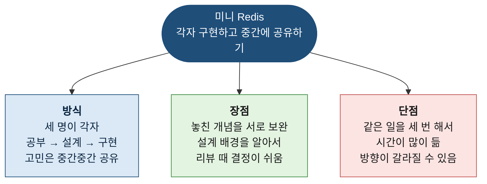
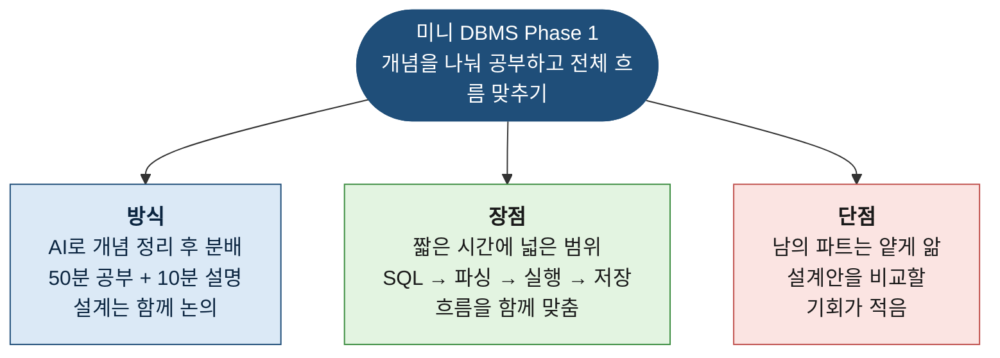

# 개복치 생존 신고센터

## 1. 협업 방식

### 미니 Redis: 각자 구현하고 중간에 공유하기




### 미니 DBMS Phase 1: 개념을 나눠 공부하고 전체 흐름 맞추기



## 2. 게임 소개와 구조

직접 만든 미니 Redis와 미니 DBMS 위에서 돌아가는 1인 웹 게임입니다. 개복치를 입양하고 새우를 주며 얼마나 오래 살리는지 겨룹니다.

```text
브라우저 ──HTTP──▶ 게임 서버(Python)
                     ├─ HTTP POST /query (SQL) ──▶ 미니 DBMS   : 입양·부고 영구 기록
                     └─ TCP RESP 명령        ──▶ 미니 Redis  : 생존 시간(TTL)·기록 캐시
```

- [run.py](run.py)가 두 엔진을 빌드하고 실행한 뒤 게임 서버를 띄웁니다.
- [engines.py](engines.py)는 외부 라이브러리 없이 두 엔진과 직접 통신합니다.

## 3. 미니 Redis

| 중점 포인트 | 엔진 구현 | 게임에서 |
| --- | --- | --- |
| 동시성 | **싱글 스레드 이벤트 루프** — 명령이 하나씩 실행돼 락이 필요 없음 | 게임 서버 여러 스레드가 동시에 보내도 순서대로 처리 |
| 만료된 값 요청 | **지연 삭제 + 주기 삭제** — 조회할 때 지우고, 100ms마다 훑어서 지움 | `SET ... PX 10000`으로 생존 시간 시작 → 키가 사라지면 굶주림 사망 |
| 외부 API | **RESP 프로토콜** — `redis-cli`로 바로 접속 가능 | 게임 서버가 RESP 명령을 직접 조립해서 보냄 |
| 무효화 | **`DEL` + TTL** — 바로 지우거나 수명이 다하면 자동 삭제 | 부고 저장 직후 `DEL mola:history`로 기록 캐시 삭제 |
| 서버 다운 대비 | **스냅샷 저장** — 임시 파일에 쓰고 교체해 저장 중 죽어도 안전 | 게임을 껐다 켜도 Redis 데이터 복구 |

**동시성: 싱글 스레드 이벤트 루프**
- `poll()` 하나로 모든 연결을 돌며 처리 → 동시에 실행되는 명령이 없음
- 한 연결이 독점하지 않도록 한 번에 32개 명령까지만 처리

**만료된 값: 두 가지 방식으로 삭제**
- 지연 삭제: `GET` 했는데 만료됐으면 그 자리에서 지우고 nil 응답
- 주기 삭제: 아무도 안 찾는 키도 100ms마다 조금씩 훑어서 회수

**게임의 생존 시간 = 키의 수명**
```text
입양  →  SET mola:alive:7 ... PX 10000   (10초 시작)
관찰  →  PTTL mola:alive:7  →  2340      (화면에 2.3초)
새우  →  남은 시간 + 4000으로 다시 SET    (15초 넘으면 과식)
만료  →  GET이 nil                       (굶주림 사망)
```

## 4. 미니 DBMS

| Phase | 중점 포인트 | 엔진 구현 | 게임에서 |
| --- | --- | --- | --- |
| 1 | SQL 처리기 | 토크나이저 → 파서 → 실행기 → CSV 파일 저장 | 입양 `INSERT`로 ID 발급, 부고 `INSERT`, 기록 `SELECT` |
| 1 | CLI | SQL 파일을 넣으면 차례로 실행 | — |
| 2 | `WHERE id = ?` | **B+ 트리에 (id, 파일 위치)** 저장 → 그 한 줄만 읽음 | — |
| 2 | 대용량 테스트 | 스크립트로 100만 건 생성 → **인덱스 24µs vs 선형 탐색 69ms** | — |
| 2 | Phase 1과 연결 | 테이블 열 때 인덱스 생성, INSERT마다 위치 등록 | — |
| 3 | 동시성 | **테이블별 읽기·쓰기 락** — 읽기는 동시에, 쓰기는 혼자 | 기록 조회와 부고 저장이 겹쳐도 안전 |
| 3 | 엔진 ↔ 서버 | 락은 엔진 안에 → 서버는 HTTP만 담당 | 게임 서버는 `POST /query`로 SQL만 보냄 |
| 3 | 서버 구조 | **스레드 풀** — accept 1개 + 작업자 4개 + 대기열 64칸 | 게임 서버의 요청을 작업자가 나눠 처리 |

**B+ 트리: 행 대신 위치를 저장**
```text
WHERE id = 42  →  트리에서 42 찾기  →  위치 1830  →  파일의 1830번째 바이트부터 한 줄 읽기
```

**API 서버: 스레드 풀**
```text
요청 → [accept 스레드] → 대기열(64칸) → [작업자 1~4] → 엔진(테이블 락) → 응답
                            가득 차면 503
```

## 5. 두 저장소를 함께: 캐시 효과

```text
기록 조회 → Redis GET mola:history
              ├─ HIT  → 바로 응답                (DBMS 호출 0회)
              └─ MISS → DBMS SELECT → Redis SET  (DBMS 호출 1회)
부고 저장 → DBMS INSERT → Redis DEL mola:history (다음 조회는 MISS)
```

**복치 기록 100번 열기** 버튼으로 같은 목록을 100번 조회해 비교합니다.

| 조건 | 조회 | DBMS 호출 |
| --- | --- | --- |
| 캐시 끔 | 100회 | **100회** |
| 캐시 켬 | 100회 | **1회** |

## 부록: 기존 README

직접 만든 미니 Redis와 미니 DBMS로 개복치를 키우는 1인 웹 게임입니다. 이름을 지어 입양하면 생존 시간이 10초부터 시작됩니다. 새우 한 마리는 4초를 더하지만, 15초를 초과하면 과식으로 죽습니다. 3초 이하로 내려갈 때마다 스트레스가 한 번씩 쌓이고, 세 번째 배고픔은 스트레스 사망, 생존 기한 만료는 굶주림 사망으로 기록됩니다.

### 브라우저에서 두 저장소까지

브라우저는 Python 게임 서버에 HTTP로 요청합니다. 게임 서버는 미니 DBMS의 HTTP API에 SQL을 보내고, 미니 Redis에는 TCP 연결로 RESP 명령을 보냅니다. 사이드바의 관측 일지에서 입양 INSERT 결과, 남은 TTL, 스트레스, 캐시 적중 여부와 DBMS 호출 수를 확인할 수 있습니다.

| 게임 동작 | 미니 DBMS | 미니 Redis |
| --- | --- | --- |
| 입양 | 이름을 INSERT하고 발급 ID를 반환 | 입양 ID에 대응하는 생존 키를 TTL 10초로 생성 |
| 수조 관찰과 급식 | | GET으로 상태를 확인하고 PTTL로 남은 시간을 읽음. 새우를 주면 남은 시간에 4초를 더해 갱신 |
| 부고 | 입양 ID와 함께 이름·생존 시간·사인을 저장 | 생존 키를 정리하고 복치 기록 캐시를 무효화 |
| 기록 조회 | 캐시 미스일 때 사망 기록을 SELECT | 조회 결과를 캐싱해 다음 요청에서 재사용 |

### TTL은 화면에서 어떻게 보이나요?

브라우저는 약 0.3초 간격으로 게임 서버에 상태를 요청합니다. 서버가 Redis에서 읽은 PTTL 값이 2,340ms라면 사이드바에는 **2.3초**가 표시됩니다. 새우를 누를 때도 서버가 남은 시간을 다시 읽습니다.

생존 기한과 메모리 회수 시점은 다를 수 있습니다. 만료 시각이 지나면 조회 결과는 GET에서 nil, PTTL에서 -2입니다. 서버는 굶주림의 생존 시간을 만료 시각 기준으로 기록합니다. 과식이나 스트레스로 생존 키를 삭제해도 GET 결과는 같으므로, 실제 사인은 미니 DBMS에 남겨 둡니다.

### 복치 기록에서 MISS와 HIT는 어떻게 다른가요?

1. **내가 키운 복치들**을 열면 게임 서버가 Redis에 `GET mola:history`를 보냅니다.
2. **MISS**이면 DBMS에서 이름·생존 시간·사인을 조회합니다. 목록을 JSON으로 Redis에 저장한 다음 브라우저에 응답합니다. 이 요청의 DBMS 호출 수는 1회입니다.
3. **다시 조회**를 누르면 캐싱된 목록으로 응답합니다. **HIT**이고 DBMS 호출 수는 0회입니다.
4. 새 부고를 DBMS에 저장한 뒤 서버가 `DEL mola:history`를 실행합니다. 다음 조회는 새 복치를 포함한 목록을 다시 채웁니다.

**복치 기록 100번 열기**는 같은 목록을 캐시 끔과 켬 조건에서 각각 100번 순차 조회합니다. 캐시 켬은 빈 비교용 키에서 시작하므로 일반적인 목록에서는 첫 요청만 DBMS에 접근합니다. 화면에는 실측 총 처리 시간과 호출 수가 표시됩니다. 첫 MISS에서 Redis에 저장하는 시간도 포함됩니다. 목록이 240,000바이트 이상이면 서버가 캐시 저장을 생략합니다.

### 로컬 실행

macOS 또는 Linux에서 Git, Python 3, `make`, C 컴파일러가 필요합니다. Windows에서는 WSL의 Ubuntu 터미널에서 같은 절차를 사용할 수 있습니다.

게임 저장소는 비공개입니다. 저장소 소유자에게 GitHub 계정 접근 권한을 받은 뒤, 해당 계정으로 인증해서 복제하세요.

빈 작업 폴더에서 다음 명령을 실행하면 게임과 실행에 사용한 두 엔진 버전을 한 번에 준비할 수 있습니다.

```sh
mkdir -p week-12
cd week-12

git clone https://github.com/1224kang/mola-survival.git

git clone -b develop https://github.com/stereokkh/jungle-mini-dbms.git mini-sql/jungle-mini-dbms
git -C mini-sql/jungle-mini-dbms checkout 6ee5e6f3d58f4a1951e5b9a41790ac70d57d5320

git clone https://github.com/Choidongho08/jungle-mini-redis.git mini-redis/mini-redis-impl/jungle-mini-redis
git -C mini-redis/mini-redis-impl/jungle-mini-redis checkout 467229894f2efd10dbcd4a6de74a87a7f2a02ed0

cd mola-survival
python3 run.py
```

`run.py`가 두 엔진을 빌드하고 게임 서버와 함께 실행합니다. 터미널을 켜 둔 상태로 브라우저에서 [수조 열기](http://127.0.0.1:8787)를 누르세요. 첫 실행은 빈 수조로 시작합니다.

기본 포트는 게임 8787, DBMS 18780, Redis 16379입니다. 두 엔진을 다른 곳에 복제했다면 각 Makefile이 있는 폴더를 지정해 실행할 수 있습니다.

```sh
MOLA_DB_SRC=/path/to/jungle-mini-dbms MOLA_REDIS_SRC=/path/to/jungle-mini-redis python3 run.py
```

게임 데이터와 빌드 결과는 로컬의 `.local/`에 보관합니다. Ctrl+C로 종료한 뒤 같은 데이터 경로에서 다시 실행하면 기록을 이어서 볼 수 있습니다. 게임은 한 수조를 공유하며 미니 DBMS 서버는 모든 네트워크 인터페이스에 바인딩됩니다.

엔진 소스는 [미니 DBMS](https://github.com/stereokkh/jungle-mini-dbms)와 [미니 Redis](https://github.com/Choidongho08/jungle-mini-redis)에서 확인할 수 있습니다. 게임의 실제 흐름은 [서버 로직](game_server.py), [저장소 연결](engines.py), [질문과 답변](질문과-답변.md)에 정리했습니다.
